# Caddie 液态玻璃（Liquid Glass）界面设计方案：iPhone + Apple Watch

> 卡：C388。Jason 11-08 经土土「趁没事用 claude 把 caddie 的液态玻璃 UI/UE 认真再设计一下 包括 ios 和手表」；11-08 04:1x 看过第一版（27a6738c）后改口：「首先这些卡的目标是出完整的设计方案 并不是执行 我琢磨着还是需要 claude code 那种设计选择 其次 球包不需要单独一页 你先多设计几种方案 头脑风暴 然后你自己打分选择最后给我一个你认为最好的 头脑风暴是为了找到更多可能性 但还是要认真评估合理性」。
> **本文是设计方案，不是实施计划。** 结构：第 2 节头脑风暴 4 套整体方案并附预览图 → 第 3 节逐套打分选出推荐 → 第 4、5 节把推荐方案每屏写全（现状截图对改后预览）。实施拆卡等 Jason 看过方案再开；C167–C173 保持原样、【未派】。
> 图：`shots/before/` 是现状，来自 CI 模拟器（native-mobile fixture run 42031847103，iPhone 390pt / 393pt，手表 41mm / 46mm，全部为 fixture 数据）；`shots/proposal/` 是改后预览，由 `liquid-glass-mock/` 里的 HTML/CSS 设计稿用无头浏览器渲染（真实的背景模糊与半透明，不是模拟器截图，系统控件的细节以实机为准）。打球页预览用仓库已有的亮色精细洞图（`2026-09-25-ui-redesign/hole1-topo.png`）做背景：亮绿草、白沙、蓝水，是强光下最难看清按钮的底色。
> 基线：main 35a402af（2026-11-07）。

## 0. 已定的事（不重议）

| 定案 | 出处 | 本方案怎么落 |
|---|---|---|
| 菜单和屏幕上所有可按的东西按液态玻璃设计框架做，全部统一、不留例外 | Jason 10-29 17:0x、10-29「再评估评估 能不能都统一」 | 每个可点控件只用系统控件和系统样式（第 1.3、1.4 节）；确需自定尺寸的写理由（第 6 节） |
| 最低 iOS 26 / watchOS 26，不做旧外观兼容 | Jason 10-29 18:2x「1，只支持 26」 | 全文不写 `#available` 兜底 |
| 跟随系统深色先不做 | 同上「2，先不做」→C174 | 普通页浅色、打球页深色，保持现状 |
| 洞屏底图永不出线条图 | C241 定案 | 方案只动浮在地图上的控件层，不碰底图选择：精细图 → Garmin 底图 → 原地换；都没有时中性底 +「地图准备中」 |
| 球包不单独成页 | Jason 11-08 04:1x | 球包留在设置里（现在就在设置里），设置页首屏直接列出球杆和距离，编辑用弹层 |
| iPad、横屏 | C170/C171 11-05 土土收卡 | 不在本方案范围；布局按系统安全区和实测尺寸写，以后做时不返工 |

## 1. 设计原则（球场上的真实使用）

### 1.1 使用场景决定的硬约束

| 场景 | 约束 | 对策 |
|---|---|---|
| 单手、拇指操作（另一只手拿杆） | 高频操作在屏幕下 1/3 的拇指区 | 记一杆、记分、开始、搜索都放底部 |
| 戴手套 | 触控不准 | 主操作 ≥ 60pt（记一杆 76pt），其余 ≥ 44pt（HIG 最小值），相邻控件间距 ≥ 8pt；手表按钮用系统 toolbar 的点击区 |
| 强光 | 低对比看不清 | 关键数字用系统粗体大字 + 等宽数字；打球页保持深色外观；记一杆用实色 tint；打球页的弹层用接近不透明的深色底（预览里试过：半透明玻璃弹层压在亮洞图上，白字发灰看不清） |
| 走路中看一眼 | ≤ 1 秒读到 | 每屏只有一个最大的信息：打球页是到果岭中的距离，手表是距离大字，成绩页是差点 |
| 口袋里、走路时误碰 | 不能误删、误结束 | 放弃本场、删一杆用系统确认；记分弹层禁止下滑关闭（现有行为） |
| **洞图是发球台在下、果岭在上** | 球手自己的位置（蓝点）在屏幕底部中间 | 底部中间不放整条按钮或抽屉，按钮只占左下、右下两个角。这一条直接淘汰了方案 A 的底部玻璃条和方案 B 的抽屉（见第 3 节） |

### 1.2 液态玻璃怎么用（Apple HIG，iOS 26 / watchOS 26）

1. **玻璃只给控件层，不给内容层**：导航栏、toolbar、浮在地图上的按钮和信息牌是玻璃；列表行、成绩卡片、计分卡表格是内容，不加玻璃。
2. **系统给的玻璃优先**：NavigationStack 的导航栏和 toolbar、sheet、Menu、confirmationDialog 在 iOS 26 自动是玻璃，不手工加 `.glassEffect`。
3. **浮在地图上的自定控件**：按钮用 `.buttonStyle(.glass)`，主操作用 `.buttonStyle(.glassProminent)` + `.tint`；不是按钮的信息牌（距离牌）用 `.glassEffect(.regular, in: .rect(cornerRadius: 24))`。相邻的玻璃放进同一个 `GlassEffectContainer`。
4. **tint 每屏只给一个主操作**：打球页是记一杆，开局是开始，首页是打一场球或继续，手表是记一杆。
5. **形状同心**：浮层用胶囊和圆，卡片圆角跟随系统（`ConcentricRectangle`），不再混用 12、16、20。
6. **动效**：用系统转场（push、sheet、zoom）；记分按钮和记分弹层之间用 `glassEffectID` 做展开变形；「减弱动态效果」「降低透明度」由系统处理。记一杆、保存记分加 `.sensoryFeedback`。
7. **字号**：普通页一律用 Dynamic Type 文字样式；地图标签、距离大字、手表距离大字和画面尺寸绑定，用固定 pt + `minimumScaleFactor`（第 6 节写理由）。

### 1.3 控件选型（iPhone）

| 用途 | 用 | 不再用 |
|---|---|---|
| 返回、标题、页内操作 | `NavigationStack` + 系统返回 + `.toolbar` | 自画圆形返回钮、自画顶栏 |
| 关闭/完成 sheet | toolbar 里 `Button(role: .close)` / `.confirm` | 自画 ✕、自画「保存」胶囊 |
| 2–4 个互斥选项 | `Picker(.segmented)` | 自画分段胶囊、自画选择卡 |
| ≥ 2 个次要操作 | `Menu`（toolbar 里的 `ellipsis`） | 并排的小胶囊 |
| 列表、设置 | `List` / `Form`、`NavigationLink`、`swipeActions` | 自画行卡片 + `.plain` 按钮 |
| 页内主按钮、次按钮 | `.borderedProminent` / `.bordered` | 自画填充或描边圆角矩形 |
| 浮在地图上和页面底部的按钮 | `.glass` / `.glassProminent`，放进 `GlassEffectContainer` | 实心白圆 + 手写阴影、`.ultraThinMaterial` 手工玻璃 |
| 破坏性操作 | `confirmationDialog` + `role: .destructive` | 自画红字按钮 |
| 进度 | `ProgressView` | 自画进度条 |
| 搜索 | `.searchable`，放底部 toolbar（iOS 26 的 `DefaultToolbarItem(kind: .search, placement: .bottomBar)`） | 自画搜索框 |

现状（盘点 main 35a402af）：iPhone 有 95 个 `.buttonStyle(.plain)` 自画按钮、11 处 `.ultraThinMaterial` 手工玻璃、0 个 `.glass`；只有 10 个 `.bordered`、6 个 `.borderedProminent`。

### 1.4 控件选型（Apple Watch）

| 用途 | 用 | 不再用 |
|---|---|---|
| 列表、菜单、设置类页面 | 每页包一层 `NavigationStack` + `List`，toolbar 放系统样式返回（路由状态机不变） | 自画 40pt 黑圆返回（左边缘右滑是手势，保留） |
| 打球仪表页的角落按钮 | `.toolbar` 的 `.bottomBar`：左边菜单用 `.glass`，右边记一杆用 `.glassProminent` 绿色 | 自画角落圆钮、手算的安全区偏移 |
| 翻页 | `TabView(.verticalPage)`，转表冠翻页 | — |
| 调数字（杆数、推杆、罚杆） | 表冠 `digitalCrownRotation` + `.glass` 的 ± 按钮 | 自画 ± 方块 |
| 确认（结束、放弃） | 保留成状态机里的一屏，按钮换成系统的 `.borderedProminent`（`role: .destructive`）和 `.bordered` | 自画胶囊 |

现状：手表 App 里没有一个 NavigationStack、toolbar、sheet 或 Menu。所有页面是 `WatchRoundModel.screen` 状态机里的 `switch`，34 个按钮全是 `.plain`，没有任何系统材质。代码注释记着 #417 在 49mm 上「记一杆」和「菜单」首点 0/5（WatchRoundContainerView.swift:1299），但没有一个 UI 测试点过这两个按钮。

## 2. 头脑风暴：4 套整体方案

先把三处最影响体验的结构拆开想，每处列出差异明显的做法，再组合成 4 套整体方案。

**iPhone 顶层导航**
- N1 标签栏：打球、成绩两个 tab，加 iOS 26 底部搜索 tab。
- N2 枢纽 + 底部工具栏：保持现在单一 NavigationStack 的首页；底部玻璃 toolbar 左边是搜索球场，右边是主按钮「打一场球 / 继续第 N 洞」；设置在右上。
- N3 球场模式：定位到球场附近时，App 一打开就是这个球场的洞图和「开始第 1 洞」，其余内容收在下面。

**打球页**
- P-A 底部玻璃条：顶栏 + 一整条底部玻璃条，里面是记分、障碍翻页、记一杆。
- P-B 地图抽屉：像「地图」App 一样常驻底部抽屉，距离、球童建议、记分、记一杆都在抽屉里，上拉看更多。
- P-C 四角拇指：系统 toolbar 顶栏（返回、洞号、更多 Menu），距离牌在右上；记分在左下（60pt），记一杆在右下（76pt）；图层按钮竖排在左边；障碍翻页条在记分上方；地图中间一整列留空。
- P-D 右侧拇指轨：所有按钮竖排进右边一条玻璃轨，右手拇指沿轨道上下够。

**手表**
- W-A 竖翻页 + 系统角落钮：保持现在三页（距离大字、球洞图、果岭/障碍），菜单和记一杆进系统 toolbar 的两个底角。
- W-B 单页仪表 + 表冠缩放：距离数字和球洞图合成一页，表冠从整洞缩放到果岭；障碍和果岭页改从菜单进。
- W-D 底部整条记一杆：距离大字下面放一整条绿色「记一杆」，菜单挪到右上。

**组合成的 4 套**

| 方案 | 导航 | 打球页 | 手表 | 一句话 |
|---|---|---|---|---|
| A「标签栏」 | N1 | P-A | W-A | 最「教科书」的 iOS 26 结构 |
| B「地图抽屉」 | N2 | P-B | W-B | 学「地图」App，信息集中在抽屉里 |
| **C「拇指枢纽」** | N2 | P-C | W-A | 结构基本不变，控件全换系统玻璃并挪进拇指区 |
| D「球场模式」 | N3 | P-D | W-D | 以球场为中心，App 一开就能打 |

**打球页 4 种（亮色洞图，强光最坏情况）**

| A 底部玻璃条 | B 地图抽屉 | C 四角拇指 | D 右侧拇指轨 |
|---|---|---|---|
| 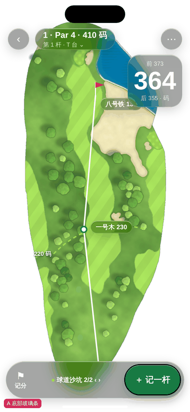 | 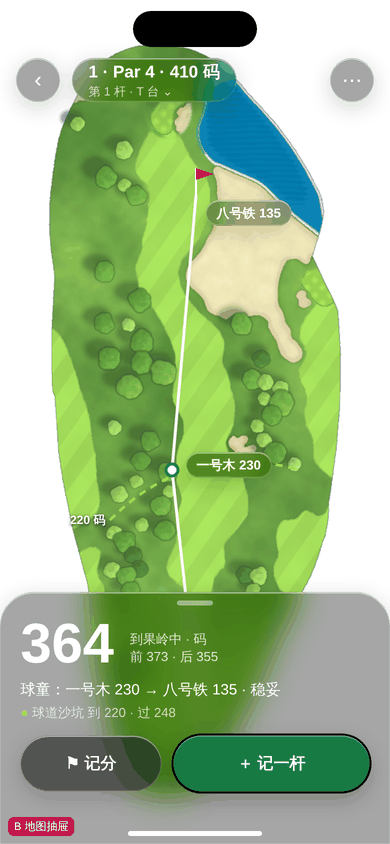 | 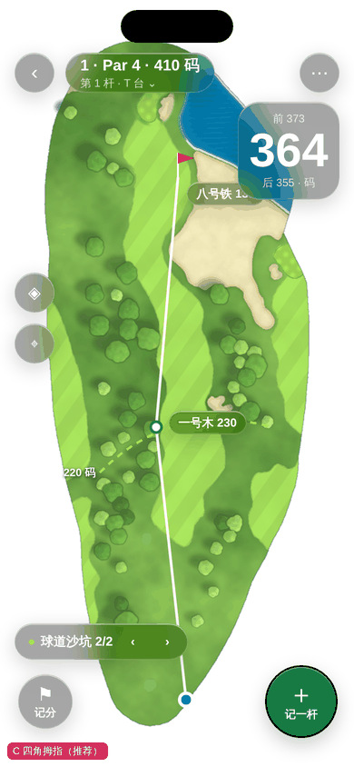 | 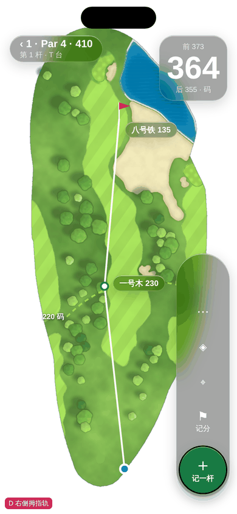 |

**首页导航 3 种 + 手表 3 种**

| N1 标签栏（A） | N2 枢纽+底部工具栏（B、C） | N3 球场模式（D） |
|---|---|---|
| 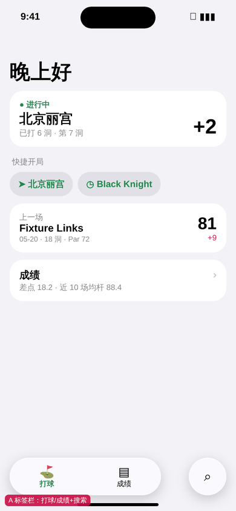 | 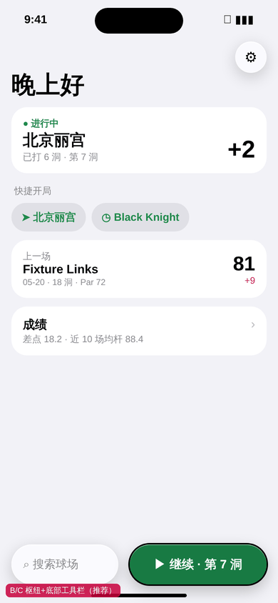 | 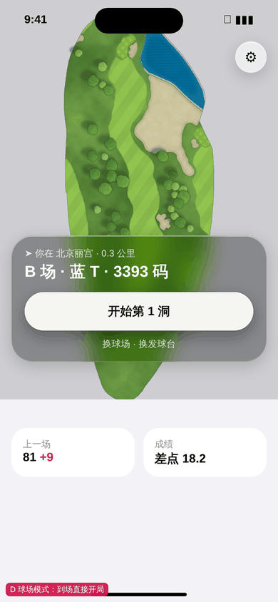 |

| W-A 竖翻页+系统角落钮（A、C） | W-B 单页仪表+表冠缩放（B） | W-D 底部整条记一杆（D） |
|---|---|---|
| 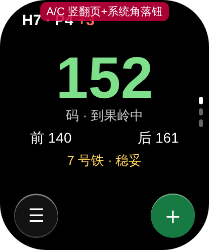 | 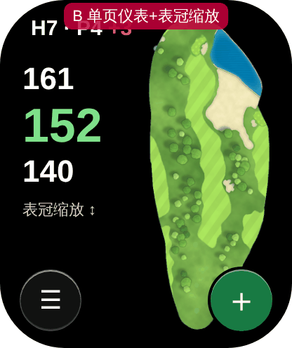 | 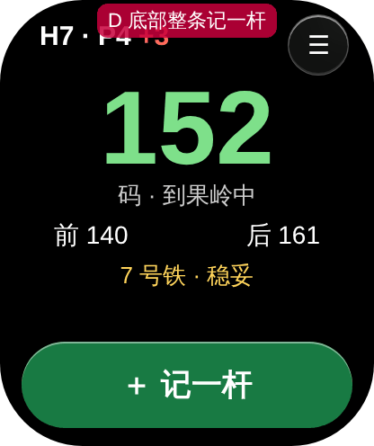 |

## 3. 打分与选择

维度和权重（满分 100；每项 1–5 分，加权后折算）：

| 维度 | 权重 | 看什么 |
|---|---|---|
| 单手拇指可达 | 20 | 记一杆、记分、开局、搜索是否都在拇指区 |
| 强光一眼可读 | 20 | 距离是否最醒目；按钮在亮洞图上是否看得清；地图被挡多少 |
| 误触风险 | 15 | 走路、戴手套时会不会点错，会不会挡住或拖动地图 |
| HIG 贴合 | 15 | 是不是苹果在 iOS 26 / watchOS 26 推荐的结构和控件 |
| 改动量与风险 | 15 | 要改多少路由和状态，会不会改到计分、建议、同步的行为 |
| 手表适配与首击 | 15 | 5 种表盘上按钮会不会出屏、能不能第一下就点中 |

| 方案 | 单手 | 强光 | 误触 | HIG | 改动 | 手表 | **总分** |
|---|---|---|---|---|---|---|---|
| A 标签栏 | 4 | 4 | 3 | 5 | 3 | 4 | **77** |
| B 地图抽屉 | 4 | 3 | 2 | 4 | 2 | 2 | **58** |
| **C 拇指枢纽** | 5 | 4 | 4 | 4 | 4 | 4 | **84** |
| D 球场模式 | 4 | 4 | 2 | 3 | 2 | 3 | **62** |

**理由**
- **A 标签栏（77）**：结构最标准，HIG 给 5 分。扣分点有三处。一是打球页的整条底部玻璃条正好压在发球台和球手的蓝点上（预览 A 里蓝点被挡住了），而这是走路时最想看的位置。二是只有「打球、成绩」两个目的地，为此加一条常驻 tab bar 收益不大。三是要把根导航改成 TabView，并把进行中的球局搬到 tab 附件栏，路由改动中等。
- **B 地图抽屉（58）**：信息最集中，但洞图是竖长的，常驻抽屉吃掉底部约 30%（预览 B 里一号木落点以下全被盖住）。抽屉的上下拖动和左右翻洞、拖瞄准点三种手势抢同一块屏，戴手套很容易误操作。弹层压在亮图上的可读性也最差（第 1.1 节）。手表把三页合成一页，表冠原本用来翻页，现在又要缩放，两者冲突；障碍和果岭也藏深了一层。
- **C 拇指枢纽（84，推荐）**：首页和路由基本不变，只把主按钮和搜索挪到底部玻璃 toolbar，改动风险最小。打球页按钮只占四个角，地图中间一整列（球手→落点→果岭）完全露出来；记一杆在右手拇指最舒服的右下角。次要操作收进右上的 Menu，误触少。手表沿用球手已经熟悉的三页，只把角落按钮交给系统 toolbar，正好对准 #417/#418/#422 的「底部点不中」根因。HIG 扣 1 分，因为没用 tab bar；但苹果对只有一两个目的地的 App 也推荐用单栈加 toolbar，不算违背。
- **D 球场模式（62）**：到场即开的体验最快，但要按定位自动切换首页，这是新的自动行为，违背「不改变功能行为」，定位不准时还会误进别的球场。右侧拇指轨对左手握机的人不友好，竖长的玻璃轨在亮图上发灰（预览 D）。手表底部整条按钮最好点，但会盖住球洞图的下半部，表冠翻到球洞图页时尤其明显。

**结论：推荐方案 C「拇指枢纽」。** 吸收 A 的一处优点：搜索放在底部（用 iOS 26 的底部 toolbar 搜索，不需要 tab bar）。

## 4. 推荐方案 C：iPhone 逐屏

每屏格式：前（现状截图）｜后（实现后截图，批号见第 6 节）；目的；信息层级（1 最重要）；控件选型；交互与动效；现状 → 改法。

### 4.0 导航结构（前后对比）

**前**（代码盘点，main 35a402af）：根是 `RoundHomeView` 的单一 `NavigationStack(path:)`（RoundHomeView.swift:1043，路由 `HubRoute`）。首页是一张长页（问候语、打一场球大卡、快捷球场、上一场、最近走势、成绩入口），右上 toolbar 齿轮开设置 sheet（:1093；球包在设置里 push，ClubSettingsView）。成绩各页 push。打球页是同一个栈里的洞 pager（`TabView(.page)`，:1461），每洞一页 `CurrentHoleView`，它把导航栏藏掉（CurrentHoleView.swift:1295）自己在地图上画顶栏和按钮。全 App 95 个 `.buttonStyle(.plain)` 自画按钮、0 个 `.glass`、11 处 `.ultraThinMaterial` 手工玻璃；只有 10 个 `.bordered`、6 个 `.borderedProminent`。

**后**（方案 C）：

```
NavigationStack（路由 HubRoute 不变）
首页（大标题问候语；右上 toolbar：设置）
  底部玻璃 toolbar：左「⌕ 搜索球场」（系统 search 工具项）｜右主按钮「打一场球」或「继续 · 第 N 洞」（.glassProminent 绿）
  ├─ 搜索 / 开始一场 → 开局设置 → 打球页（洞 pager，路由不变）
  ├─ 成绩卡 → 成绩 → 表现分析 / 时间与频率 / 成绩分布 / 球场 / 全部球局 → 复盘 → 落点图
  └─ 设置（sheet）：球包（首屏直接列出）、离线球场、账号
打球页：系统 toolbar 顶栏；果岭详情 fullScreenCover；sheet：记分、选杆、计分卡、转场、结束本场
```

- 理由：真正的目的地只有两个（打球、看成绩），单栈 + 底部 toolbar 足够，不为两个目的地加常驻 tab bar（第 3 节 A 与 C 的比较）。主按钮和搜索都在拇指区。
- 球包不单独成页（Jason 11-08）：仍在设置里，设置首屏就能看到每支杆的距离，改距离用弹层。
- 功能不变：页面、入口、数据都在；路由表 `HubRoute` 不动。

### 4.1 登录

| 前 | 后（预览） |
|---|---|
| 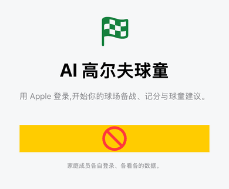 | 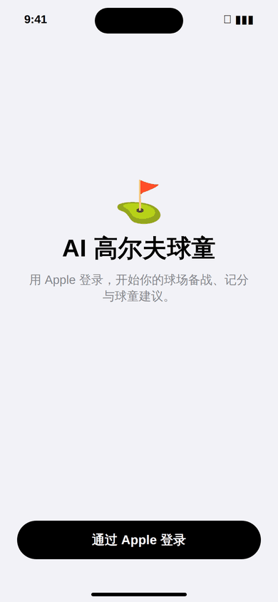 |

- 目的：第一次打开时用 Apple 登录。
- 层级：1 App 名和一句说明；2 Apple 登录按钮。
- 控件：系统 `SignInWithAppleButton`（`.signInWithAppleButtonStyle(.black)`，高 50pt，放底部安全区内 `safeAreaInset(edge: .bottom)`）；标题用 `.largeTitle.bold()`，说明 `.body` 次要色。
- 前 → 后：现在按钮在屏幕中部（模拟器截图里是系统占位黄块）；改到底部拇指区，上方留品牌区。行为不变。

### 4.2 首页

| 前 | 后（预览） |
|---|---|
| 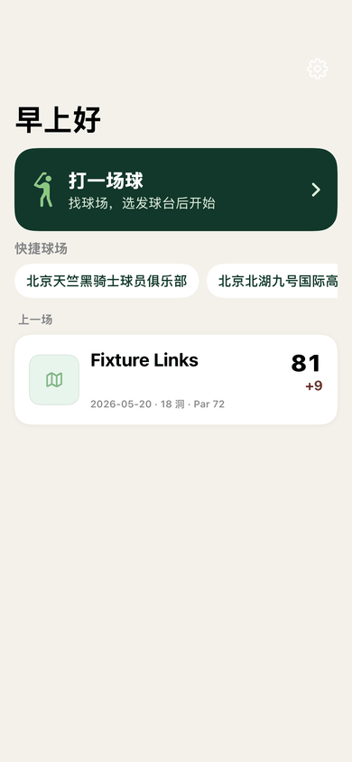 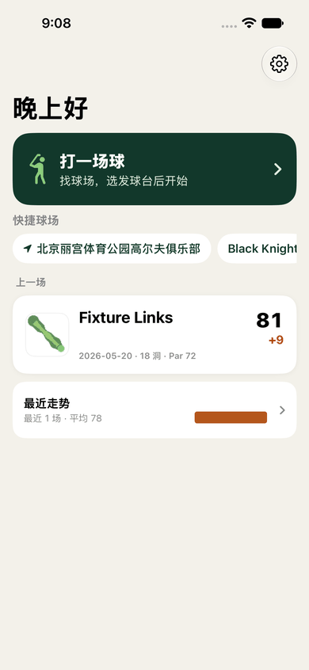 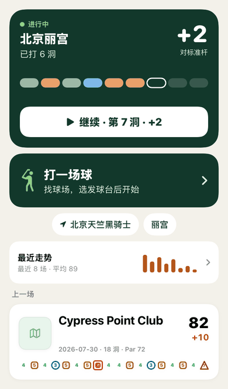 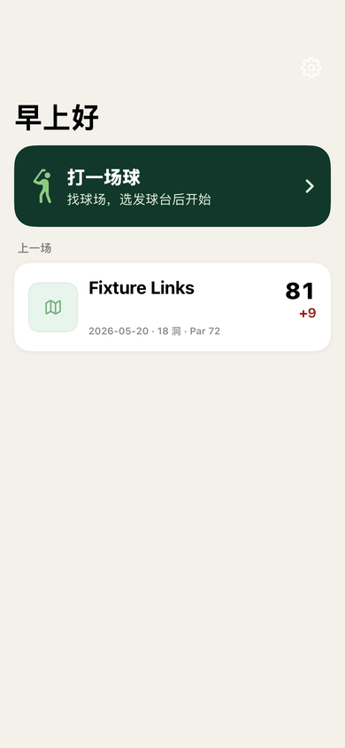 | 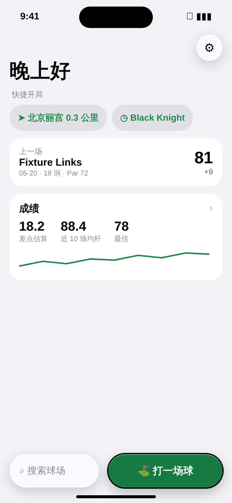  |

- 目的：一眼知道「现在该干什么」：有进行中的球局就继续，没有就开一场。
- 层级：1 主操作（继续第 N 洞 / 打一场球）；2 进行中球局卡或快捷开局；3 上一场；4 成绩摘要（差点、均杆、走势）。
- 控件：
  - 导航栏：`.navigationTitle("晚上好")` 大标题；右上 `ToolbarItem(.topBarTrailing)` 设置（`Button("设置", systemImage: "gearshape")`，系统玻璃）。
  - 底部 toolbar（`ToolbarItemGroup(placement: .bottomBar)`，iOS 26 自动玻璃）：左边是系统搜索工具项（`DefaultToolbarItem(kind: .search, placement: .bottomBar)` 配 `.searchable`），点开后在底部输入，结果就是 4.4 的球场列表；右边是 `.buttonStyle(.glassProminent)` 绿色主按钮，没有球局时显示「打一场球」，有球局时显示「继续 · 第 7 洞」。
  - 进行中球局卡：内容卡，写球场、已打几洞、对标准杆；点卡片也能进打球页，但主按钮只有底部那一个。
  - 快捷开局：`.buttonStyle(.bordered)` + 胶囊形，高 44pt，前面配系统图标 `location.fill`（附近）或 `clock`（常去）。
  - 上一场、成绩摘要：内容卡，整卡是 `NavigationLink`。成绩摘要卡带差点、近 10 场均杆、最佳和一条走势线，点进成绩页。
- 动效：进打球页用 `.navigationTransition(.zoom)`，从主按钮放大展开；下拉刷新用 `.refreshable`。
- 前 → 后：主操作从页面中上部的自画深绿大卡挪到底部拇指区；搜索从「开始一场」页里挪到首页底部；「最近走势」并进成绩摘要卡。

### 4.4 开局·选球场（搜索/附近）

| 前 | 后（预览） |
|---|---|
| 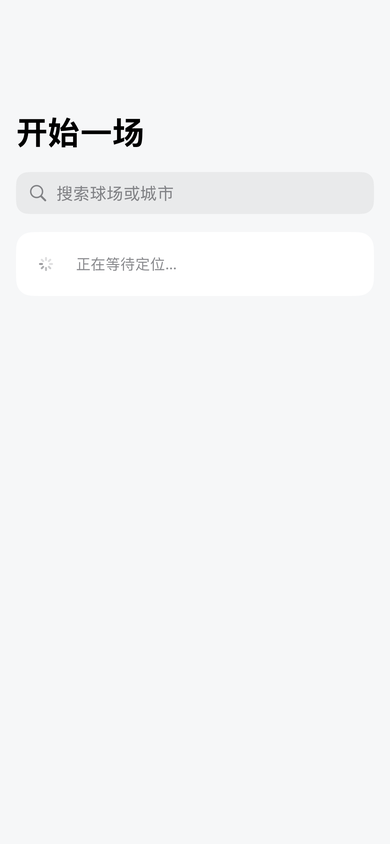 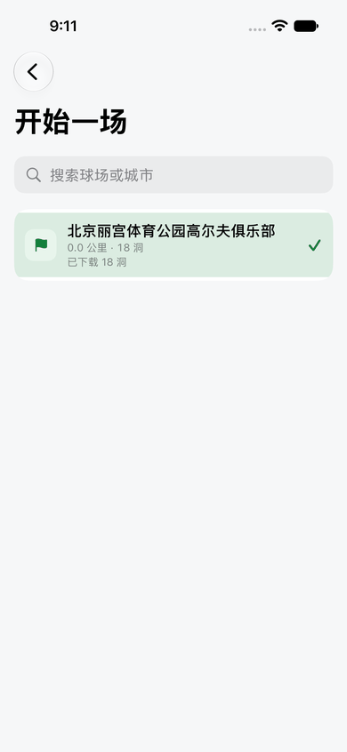 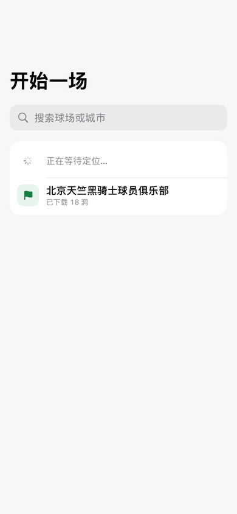 | 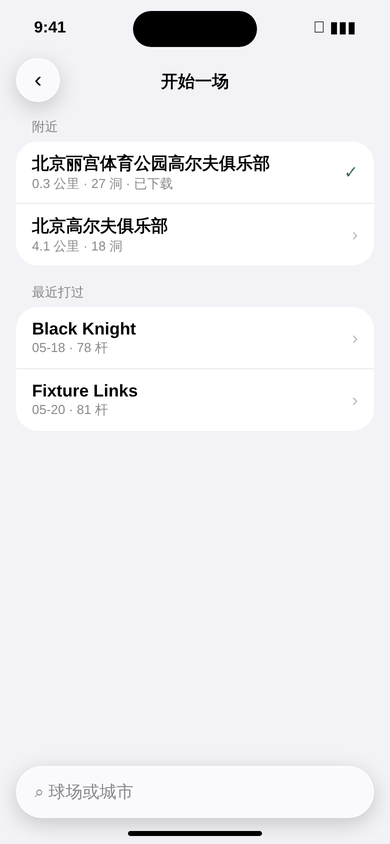 |

- 目的：到了球场，最快找到「我脚下这个球场」。
- 层级：1 附近（按距离，带「已下载」状态）；2 最近打过；3 搜索结果。
- 控件：`List` 分 Section（附近 / 最近 / 搜索结果）；`.searchable(text:, placement: .automatic)`（从首页底部搜索进入时输入框在底部）；行用 `LabeledContent` 风格：球场名 `.headline`、距离·洞数 `.subheadline` 次要色、已下载用系统 `checkmark.circle.fill` 或进度 `ProgressView(value:)`；定位中用 `ProgressView` + 「正在等待定位…」系统样式行；失败行用 `ContentUnavailableView` + 「重试」`.bordered`。
- 交互：点行 push 开局设置（2.5）；滑动行 `swipeActions` 无（不增功能）。
- 前 → 后：自画搜索框、自画返回圆钮、自画选中行（绿底+勾）→ 系统 searchable、系统返回、系统 List 选中态。

### 4.5 开局·设置（前后九/起始半场、发球台）与球场详情

| 前 | 后（预览） |
|---|---|
| 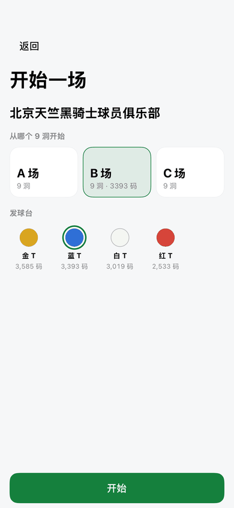 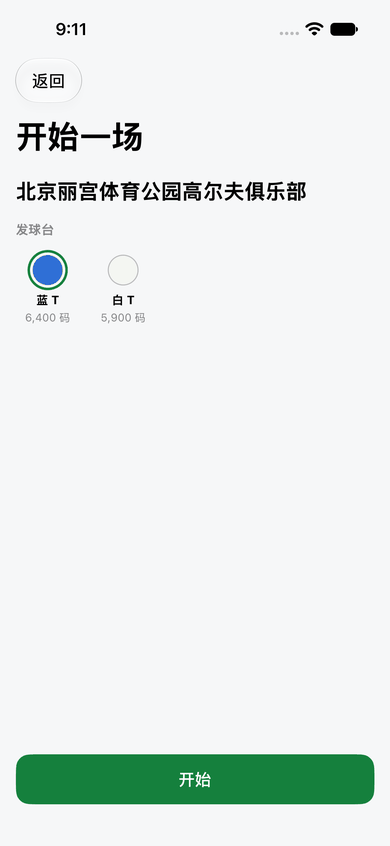 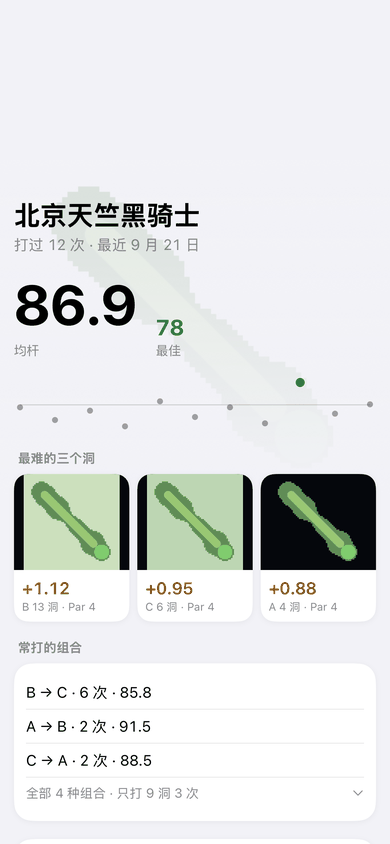 | 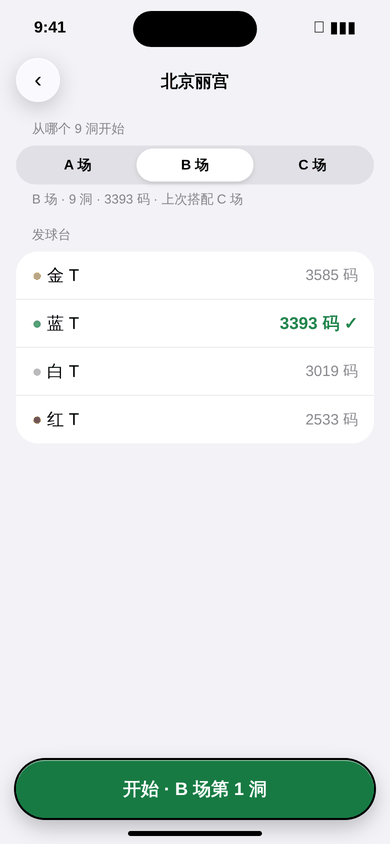 |

- 目的：确认从哪个 9 洞开始、打哪个发球台，然后开打。
- 层级：1 球场名；2 从哪个 9 洞开始；3 发球台（颜色+码数）；4 开始。
- 控件：
  - 起始 9 洞：选项 ≤4 个时 `Picker(.segmented)`（A 场 / B 场 / C 场），每段下方的「9 洞 · 3393 码」放在 Picker 下面一行 `.footnote`；>4 个时用 `List` + 勾选。
  - 发球台：`List` 行（色点 `Circle().fill(teeColor)` + 名称 + 码数），选中用系统 `checkmark`；不再用自画大色圆。
  - 开始：`safeAreaInset(edge: .bottom)` 里 `.glassProminent` + `.controlSize(.extraLarge)` 全宽，tint 球场绿。
  - 顶部：系统返回（去掉文字「返回」自画按钮）；球场名做 `.navigationTitle`。
  - 球场详情：`ScrollView` 内容卡；「最难的三个洞」横向卡片；「常打的组合」`DisclosureGroup`（替代自画「全部 4 种组合 ⌄」）。
- 前 → 后：底部「开始」现在是自画绿色矩形，改系统玻璃突出按钮；半场三块自画卡改 segmented。

### 4.6 打球页（含开局前预览；核心页）

| 前 | 后（预览） |
|---|---|
| 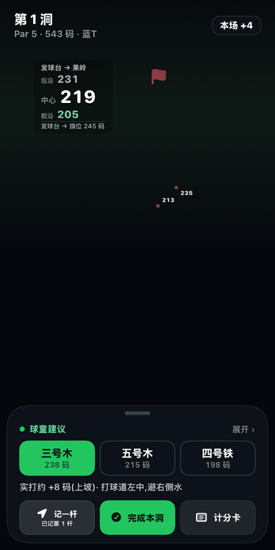  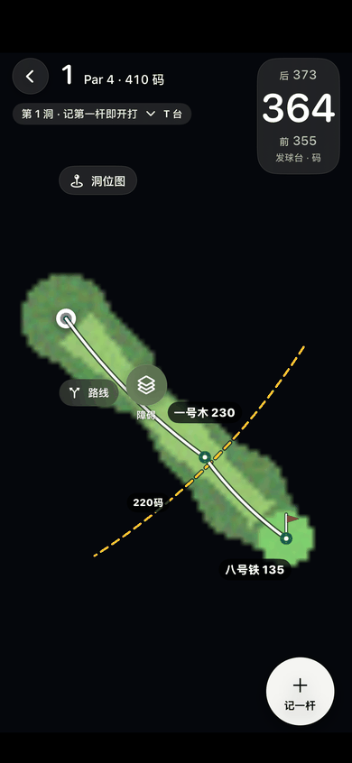 | 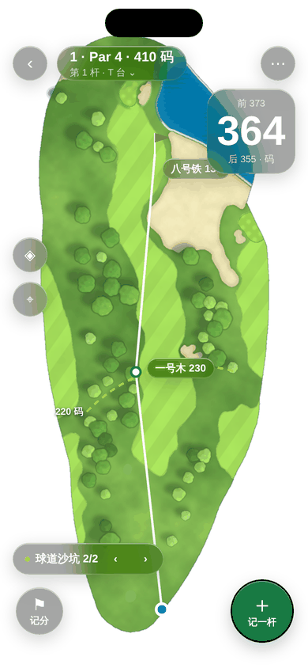 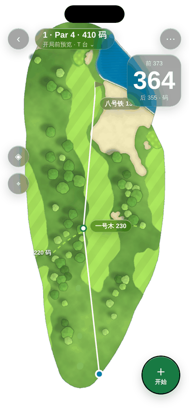 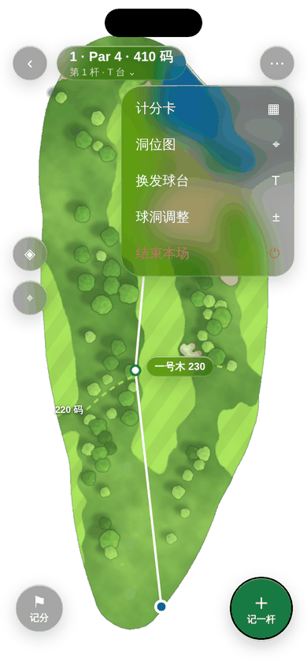 |
| 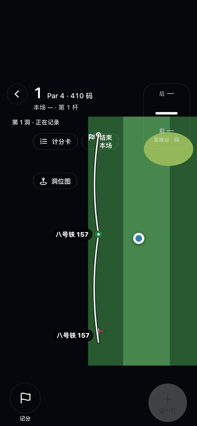 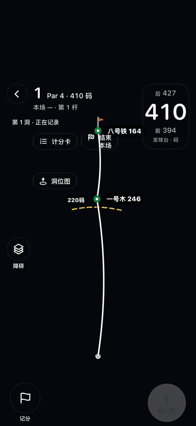 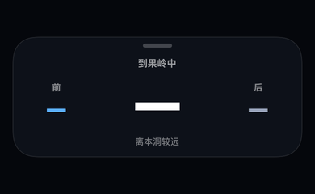 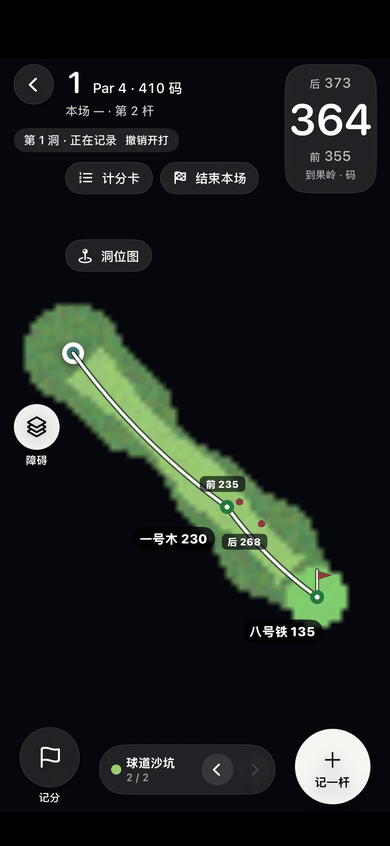 | 布局同上；Garmin 底图、无定位、离场、已开打四种状态只换底图和距离牌文字，控件位置不变 |

- 目的：走路中看一眼就知道「到果岭还有多远、这杆怎么打」，单手点「记一杆」。
- 层级：1 到果岭中距离（大字）；2 当前洞号/Par/码数；3 前/后距离、球童建议路线与落点；4 障碍翻页、图层；5 计分卡、结束本场、洞位图等次要操作。
- 布局（竖屏，地图铺满全屏 `ignoresSafeArea()`，控件全部在系统安全区内）：

```
┌───────────────────────────────┐
│ ‹  1 · Par 4 · 410 码      ⋯ │ ← 系统 toolbar（玻璃）：返回 / 标题+副标题 / 更多 Menu
│    第 1 杆 · T 台 ⌄            │   副标题是发球台 Menu（换 T 台）
│                     ┌──────┐ │
│                     │前 373│ │ ← 距离牌：.glassEffect(.regular, .rect(cornerRadius: 22))
│                     │ 364  │ │   中距离 64pt 粗体 monospacedDigit，强光下最醒目
│                     │后 355│ │
│ (◎)                 └──────┘ │ ← 左侧竖排 .glass 圆钮 44pt：图层（路线/障碍）、洞位图
│ (≡)        [地图]             │
│                               │
│  ╭ 球道沙坑 2/2  ‹ › ╮        │ ← 障碍翻页条：.glass 胶囊（同一 GlassEffectContainer）
│ ( 记分 )          (＋ 记一杆) │ ← 底部 safeAreaInset：记分 .glass 60pt；记一杆 .glassProminent 76pt
└───────────────────────────────┘
```

- 控件：
  - 顶栏：去掉 `.toolbar(.hidden)`，用所在 NavigationStack 的系统 `.toolbar`（实现时第一步先在洞 pager 里实测 toolbar 能否随当前页正确切换；不能就退一步：同样位置用 `.buttonStyle(.glass)` 按钮 + `GlassEffectContainer` 叠在地图上，仍是系统样式，不再自画圆）：`.topBarLeading` 返回（系统 chevron）；`.principal` 标题「1 · Par 4 · 410 码」+ `.navigationSubtitle`「第 1 杆 · T 台」（副标题点开是发球台 `Menu`，替代现在的自画「第 1 洞 · 记第一杆即开打 ⌄ T 台」小胶囊）；`.topBarTrailing` 一个 `Menu`（`ellipsis`）：计分卡、洞位图、球洞调整（加打/移除）、结束本场（`role: .destructive`，进确认）。现在并排的「计分卡」「结束本场」两个小胶囊（`ip-score-cancelled-393`）收进 Menu。
  - 距离牌：不是按钮，是信息牌，用 `.glassEffect`；点它切「到旗杆/到果岭中」保持现有行为（如有）。
  - 记一杆：`.buttonStyle(.glassProminent)`、`.tint(球场绿 #187A43)`、白色 `plus` 图标和「记一杆」两行字、外圈 2pt 黑描边、直径 76pt。颜色按第 6 节实测选定：近白在亮图和沙坑上对比度只有 1.1:1，绿色加黑圈在 6 种地面上都 ≥ 3:1。
  - 记分：`.glass` 圆 60pt + 下方「记分」`.caption`。点开是记分弹层（2.8），按钮和弹层用 `glassEffectID` 做展开变形。
  - 左侧图层/洞位图：`.glass` 圆 44pt，`Label` 只显图标（`.labelStyle(.iconOnly)`），带 `accessibilityLabel`。
  - 障碍翻页条：`.glass` 胶囊，‹ › 是系统 `Button(systemImage:)`，44pt 点击区。
  - 所有浮层放进一个 `GlassEffectContainer(spacing: 12)`，玻璃互相融合、采样一致。
- 取景：地图按「系统安全区 + 实测浮层框」算四边留白，替换写死顶部 80、底部 34（现在 32 处引用）；浮层尺寸变了取景跟着变，不被按钮盖住。点击坐标换算用同一份留白。
- 底图：完全不动（C241：精细图→Garmin 底图→原地换；都没有时中性底+「地图准备中」；没投影时图上写「路线等精细地图出来后显示」）。
- 交互与动效：左右滑切洞（现有）；记一杆成功 `.sensoryFeedback(.success)`；记分展开用玻璃变形；减弱动态效果时只淡入淡出（系统自动）。
- 开局前预览（prep）：同一页面，底部「记一杆」换成「开始第 1 洞」（同位置、同样式），顶栏标题同上。
- 前 → 后：实心白圆+手写阴影 → 系统 glassProminent；自画顶栏 → 系统 toolbar（自带玻璃和返回）；两个顶部小胶囊 → Menu；写死 80/34 → 实测。

### 4.7 打球页·球童打法、障碍、果岭详情

| 前 | 后（预览） |
|---|---|
|   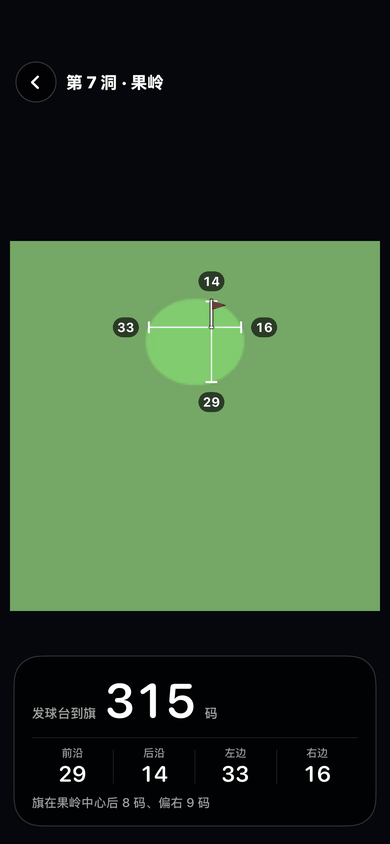 | 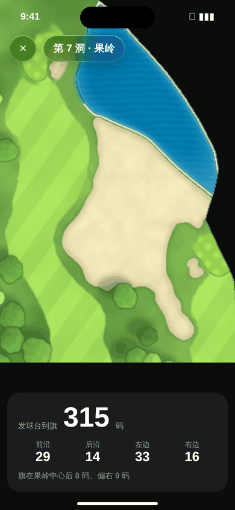 |

- 目的：看这洞的打法路线（球童建议）、某个障碍的前后距离、果岭前后左右与旗位。
- 控件：打法路线、障碍是地图上的叠加（内容层，不是玻璃）；路线标签「一号木 230」保留现有画法（和图绑定，第 5 节）；障碍翻页条见 2.6。果岭详情（现为 fullScreenCover，CurrentHoleView.swift:1667，左上自画黑圆 chevron LiveGreenDetailView.swift:246）：包一层 `NavigationStack`，toolbar `.topBarLeading` `Button(role: .close)`；下方读数卡（发球台到旗 315 码、前/后/左/右）是内容卡，`Grid` 排版，数字 `.title.monospacedDigit()`。
- 盘点发现 `LiveHazardDetailView`、`CaddiePlanView`、`LivePlayHeader`、`LiveCaddiePlanPanel`、`LiveHazardBrowserPanel`、旧 `RecordShotButton`/`HoleScoreSteppers` 已不在 App 里出现，只剩快照测试引用 → 实现时删除（连同只测它们的快照）。
- 前 → 后：果岭页自画返回 → 系统关闭；读数卡字号改 Dynamic Type（上限 `.accessibility2`，地图区不缩）。

### 4.8 打球弹层：记分、选杆提示、计分卡、转场、结束本场

| 前 | 后（预览） |
|---|---|
| 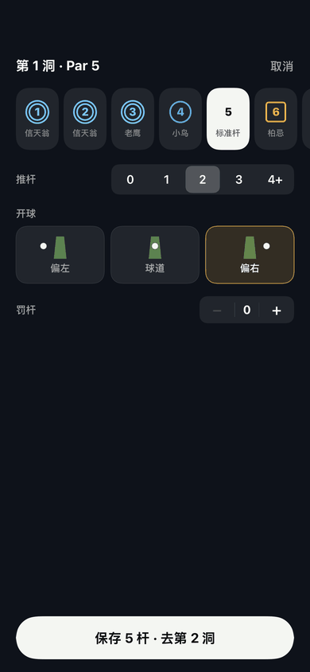 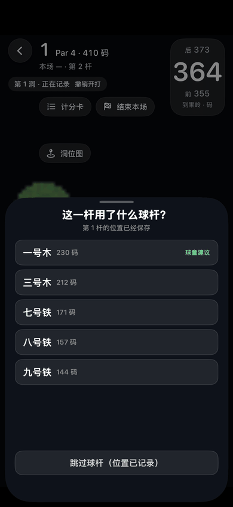 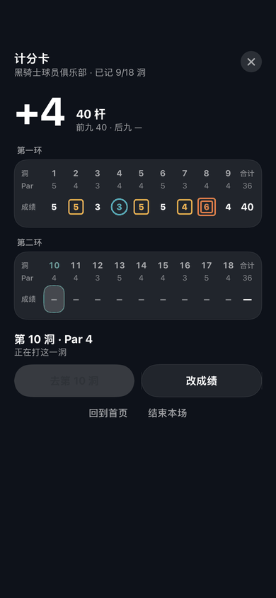 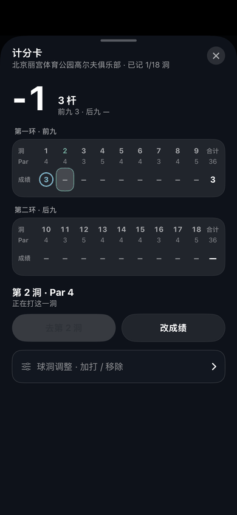 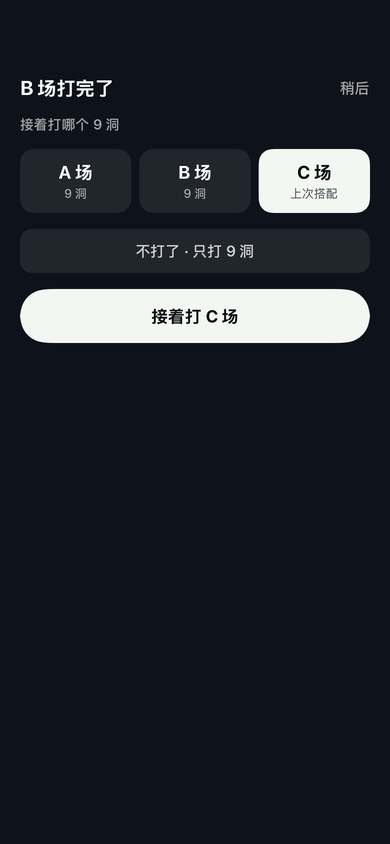 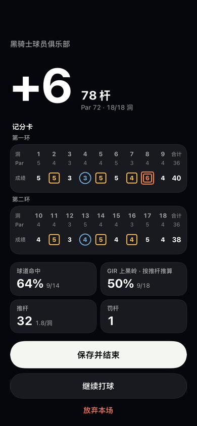 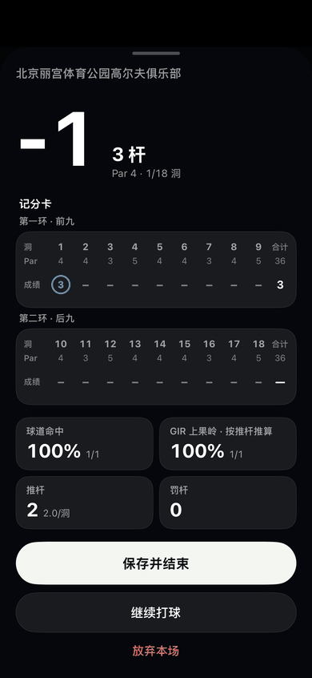 | 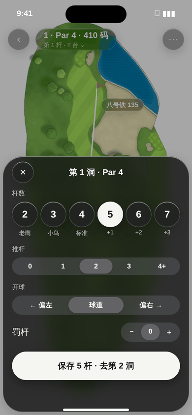 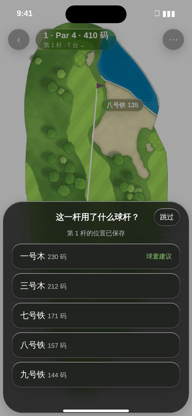 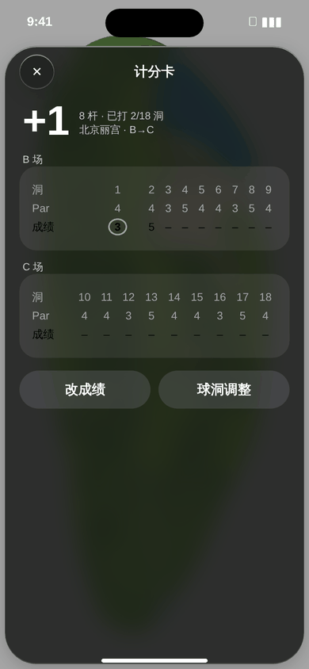 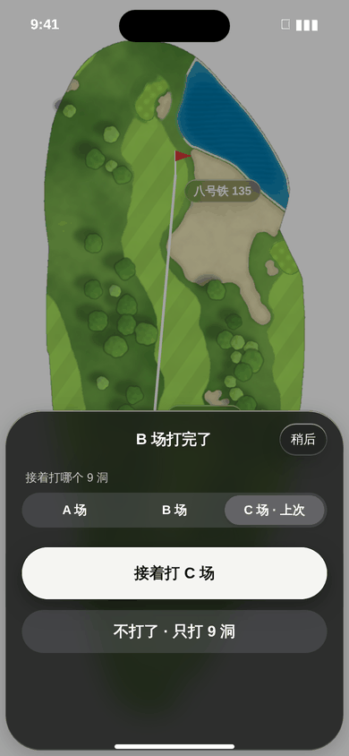 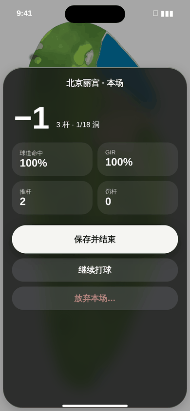 |

- **记分**（目的：洞打完 3 秒内记好杆数、推杆、开球方向、罚杆）：
  - 系统 `.sheet`，`.presentationDetents([.medium, .large])`，`.presentationBackground` 不设（iOS 26 部分高度 sheet 自动玻璃）。
  - toolbar：`.cancellationAction` `Button(role: .cancel)`（替代右上自画「取消」）；`.confirmationAction` 无——保存放底部。
  - 杆数：一排 `.glass` 圆钮（信天翁…+3，6 个，≥ 52pt），当前选中用 `.glassProminent` tint；推杆 0/1/2/3/4+：`Picker(.segmented)`；开球偏左/球道/偏右：`Picker(.segmented)` 带图标；罚杆：系统 `Stepper`（理由：0–3 小范围，系统 Stepper 足够，且有 VoiceOver 调整）。
  - 保存：底部 `.glassProminent` 全宽「保存 5 杆 · 去第 2 洞」，`.sensoryFeedback(.success)`。
- **选杆提示**（这一杆用了什么球杆？；代码在 LiveHoleComponents.swift:1125，和打球页同一处代码）：`.sheet` `.presentationDetents([.medium])`；`List` 行「一号木 230 码」+ 右侧「球童建议」`.badge`；「跳过球杆（位置已记录）」放 toolbar `.cancellationAction`。
- 弹层底色（打球页所有 sheet）：iOS 26 部分高度的 sheet 默认是半透明玻璃，压在亮洞图上白字发灰（预览初稿实测看不清）→ 统一 `.presentationBackground(.thickMaterial)`（深色外观下接近不透明的深底），大高度时系统本来就不透明。
- 记分弹层现在写死 `.height(400/500)` 且禁止下滑关闭（LiveScoreConfirmationView.swift:33-35）→ 改 `.medium/.large`，保留「禁止下滑关闭」（防误触丢记分，现有行为）。
- **计分卡**：`.sheet` `.large`；toolbar 左 `Button(role: .close)`（替代自画 ✕ 圆，LiveRoundScorecardView.swift:106-125）；内嵌的「球洞调整」区代码在 CurrentHoleView.swift:6094，已经是系统 Menu，不动；表格 `Grid`（内容层），当前洞用系统 tint 圈；「改成绩」「球洞调整」放底部 `.bordered` / 列表行。
- **转场（B 场打完了）**：`.sheet` `.medium`；三个半场选项 `Picker(.segmented)` 或 List（>3 时）；「接着打 C 场」`.glassProminent`；「不打了 · 只打 9 洞」`.bordered`；「稍后」toolbar `.cancellationAction`。
- **结束本场/汇总**：`.sheet` `.large`；「保存并结束」`.glassProminent`；「继续打球」`.bordered`；「放弃本场」`.bordered` + `role: .destructive`，点后 `confirmationDialog`（现有确认语不变）。
- 前 → 后：自画白胶囊/红字按钮、自画顶部 grabber 和 ✕ → 系统 sheet、系统 close/cancel、系统按钮样式。保存、撤销、记分写入逻辑不动。

### 4.9 复盘：全部球局、单场复盘、落点图、编辑

| 前 | 后（预览） |
|---|---|
| 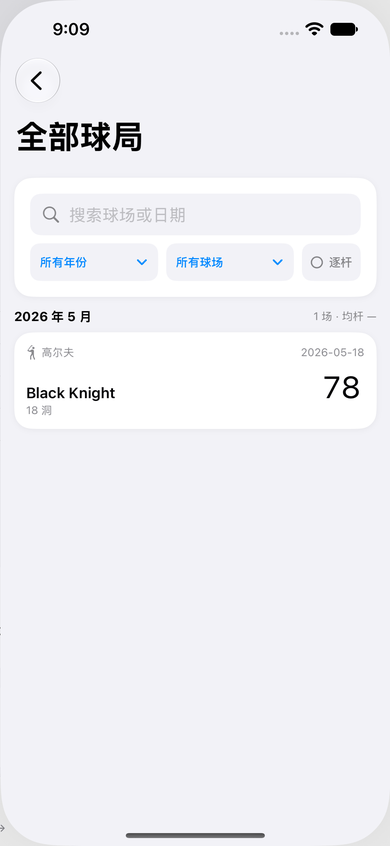 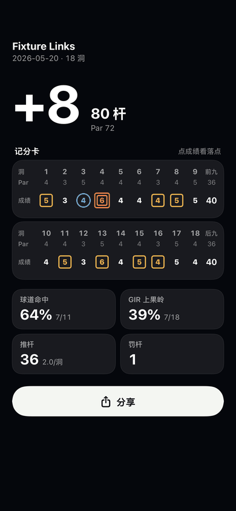      |   |

- 全部球局：`List`（按月 Section）+ `.searchable`（球场或日期）；筛选「所有年份 / 所有球场 / 9 洞」改 toolbar `Menu`（`line.3.horizontal.decrease`），去掉自画筛选胶囊行。
- 单场复盘：系统返回；toolbar 右 `ShareLink`（替代底部自画「分享」大按钮）；计分卡 `Grid`（内容层）。
- 落点图：push 页，地图铺满；toolbar 左 `Button(role: .close)`、标题「第 1 洞 · Par 4」、右「编辑」（系统 `EditButton` 语义）；底部洞条：横向 `ScrollView` 里 `.glass` 胶囊（每洞一个，选中 `.glassProminent`）放 `safeAreaInset(edge: .bottom)`，一个 `GlassEffectContainer`。
- 盘点发现的缺陷：从「球场 → 洞历史」push 进落点图时 `onClose` 为空、导航栏又被藏（RoundShotMapView.swift:741；StatsView.swift:512），页面上没有返回钮，只能边缘右滑。改成系统 toolbar 后两条入口都有系统返回/关闭。
- 编辑：toolbar 左「取消」`role: .cancel`、右「保存」`role: .confirm`；推杆/罚杆 系统 `Stepper` 放底部玻璃条；删除一杆 `confirmationDialog`。
- 前 → 后：自画 ✕/编辑/保存胶囊、自画洞条 → 系统 toolbar 与玻璃胶囊。

### 4.10 成绩及子页

| 前 | 后（预览） |
|---|---|
|       |  |

- 目的：回家后看「我差点多少、哪里丢杆」。
- 层级：1 差点估算（大字）；2 走势图；3 近 10 场均杆/最佳/场数；4 最近球局；5 分析入口。
- 控件：系统返回 + `.navigationTitle("成绩")` 大标题；范围「近 10 场 / 近 20 场 / 近一年 / 全部」与粒度「逐场 / 月 / 季 / 年」都改 `Picker(.segmented)`（现在是自画分段胶囊）；分析入口是 `NavigationLink` 内容卡；空/加载/部分失败用 `ContentUnavailableView` / `ProgressView` / 系统 `.bordered`「重试」。
- 前 → 后：自画返回圆钮 → 系统返回；自画分段 → 系统 segmented；数字 `.largeTitle.monospacedDigit()`。

### 4.11 设置（含球包，球包不单独成页）

| 前 | 后（预览） |
|---|---|
|       |  |

- 现状：设置是 sheet，里面已经是 NavigationStack + List + toolbar「完成」（RoundHomeView.swift:2224、:2326）。球包是设置里 push 进去的一整页（ClubSettingsView.swift:108），编辑用写死 `.medium` 的 sheet 加自画「完成」（:344）。
- 后：
  - 设置 sheet，toolbar 左 `Button(role: .close)`。
  - 第一个 Section「球包（13 支 · 已同步）」直接列出常用球杆：杆名、距离条（内容，保留现在的画法）、中位数；最后一行「全部 13 支 · 编辑」。点任意一行打开编辑弹层（`.sheet` + `Form`：名称、显示距离；toolbar 左 `.cancel`、右 `.confirm`）；添加球杆是 Section 头的 `Button(systemImage: "plus")`；删除用 `swipeActions(role: .destructive)`。不再 push 一整页球包。
  - 离线球场：每行 `ProgressView(value:)` + 「7/18」；用蜂窝数据预下载用系统 `Toggle`。
  - 账号：Garmin 会话、服务器（push）；退出登录用 `role: .destructive` + `confirmationDialog`。
  - 同步状态、恢复中、失败用系统的 `ProgressView`，以及带「重试」的 `ContentUnavailableView`。

## 5. 推荐方案 C：Apple Watch 逐屏

手表的使用方式：抬腕 ≤ 2 秒看距离，偶尔点一下记一杆，洞打完转表冠记分。原则：仪表页画面（距离大字、球洞图、果岭图）不动，只把**按钮**换成系统 toolbar 按钮——它们由系统放在每种表盘的安全角落，点击区由系统给，这是解决 #418/#422 四次「底部点不中」（49mm 记一杆首点无效、41mm 计分卡第 4 行、46/49mm 转场按钮出屏、45mm 首点无效）的根本办法，而不是继续手量偏移。

### 5.0 导航结构（前后对比）

**前**（代码盘点）：手表 App 里没有一个 NavigationStack、toolbar、sheet、Menu。所有页面是一个状态机：`WatchRoundModel.screen`（WatchRoundModel.swift:13）在 `WatchRoundContainerView` 里 `switch` 换页（WatchRoundContainerView.swift:471-676）。返回钮是自画 40pt 黑圆（`WatchInstrumentBackButton`，WatchEdgeBackGesture.swift:18）加左边缘右滑手势；仪表页角落 ☰/＋ 是自画 40pt 圆（50pt 点击区，`rootControl` :1305-1332，位置靠手算 `rootRailBottom`）。按钮样式只有 `.plain`（34 处），没有任何系统材质。代码注释记着 #417 在 49mm 上 W01 记一杆 / W02 菜单首点 0/5（:1299-1300），但**没有任何 UI 测试点过 ☰ 或 ＋**。

**后**：

```
路由不变：仍是 WatchRoundModel.screen 状态机（不改状态机 = 不改功能行为）
每个页面自己包一层 NavigationStack，只为拿到系统 toolbar 和系统标题：
├─ 开始 / 开局设置（半场 → 发球台）/ 菜单 / 计分卡 / 选洞 / 转场 / 设置 / 球杆统计：
│     NavigationStack { List … }.navigationTitle(…)
│     .toolbar { ToolbarItem(.cancellationAction) { 系统样式返回 → model 回上一屏 } }
└─ 打球仪表（TabView(.verticalPage)，表冠翻页，页面顺序不变）
     页 1 距离大字（前/中/后 + 建议杆）　页 2 球洞图（当前一杆、瞄准线）　页 3 果岭 / 障碍
     toolbar：.topBarLeading 洞号「H7 · P4 +3」（只读）；
              .bottomBar 左 ☰ 菜单（.glass）、中 撤销「第 2 杆 ↺」（有时才出现，.glass）、右 ＋ 记一杆（.glassProminent 绿）
     图层 .ignoresSafeArea() 满屏画，按钮在系统 toolbar 位置
```

- 返回：自画 40pt 黑圆 → 系统 toolbar 按钮（玻璃、系统点击区）。左边缘右滑是手势不是控件，保留（现有行为）。实现时把 `WatchInstrumentBackButton/Header` 的实现换成系统 toolbar 写法，各页调用点不变，所有页面一起换。
- 仪表页保持满屏：`WatchFullWindowCanvas` 的手量表盘边距表只在快照里用（真机读系统安全区），按钮进 toolbar 后不再需要它给按钮定位；快照改按 5 种真实表盘尺寸渲染。
- 长按开菜单（:1230）保留。

### 5.1 开始、开局设置（半场、发球台）

| 前 | 后（预览） |
|---|---|
|    |  |

- 控件：`List`；行用系统按钮行（`.listItemTint`）；发球台行：色点 + 名称 + 码数（码数未知写「码数未知」`.footnote`），当前选中系统 `checkmark`；底部提示「可立即开局 · 球场数据后台补齐」用 `Section` footer。标题用 `.navigationTitle`（系统在左上、和返回同排）。
- 前 → 后：自画圆形返回 + 自画标题 → 系统返回与标题；行背景自画圆角 → 系统 List 行。

### 5.2 打球·距离大字（页 1）与常亮

| 前 | 后（预览） |
|---|---|
|        |   |

- 目的：抬腕一眼看到中距离。
- 层级：1 中距离（最大，现有字号不缩）；2 前/后；3 建议杆与「稳妥」；4 洞号与比分（toolbar 标题）。
- 控件：画面不动；角落按钮改 toolbar：`ToolbarItemGroup(placement: .bottomBar)` 左 ☰（`Button("菜单", systemImage: "line.3.horizontal").buttonStyle(.glass)`）、右 ＋（`.buttonStyle(.glassProminent).tint(.green)`，`accessibilityLabel("记一杆")`）。洞号「H7 · P4 +3」放 `.topBarLeading`（只读）。
- 常亮（降低亮度）：只显示距离，toolbar 按钮系统自动淡化（`isLuminanceReduced` 时现有行为不变）。
- 等待定位：中距离位置显示「等待定位」（现有），＋ 按钮保持可点（现有行为）。
- 前 → 后：自画角落圆钮 → 系统 toolbar 玻璃按钮；首击命中由系统点击区保证，并用五表盘 UI 测试证明。

### 5.3 打球·球洞图（页 2）与当前一杆

| 前 | 后（预览） |
|---|---|
|    |  |

- 控件：图不动（D02「根页只画当前一杆」不变）；左侧 300/287/273 读数不动；toolbar 同 3.2；撤销条「第 2 杆 ↺」改 `.glass` 胶囊按钮放 `.bottomBar` 中间（系统三槽 bottomBar：左菜单、中撤销、右记一杆）。
- 前 → 后：撤销条从自画文字+图标 → 系统玻璃胶囊，点击区 ≥ 44pt。

### 5.4 打球·果岭预览、障碍、旗向（页 3）

| 前 | 后（预览） |
|---|---|
|     | toolbar 同 5.2；画面不动 |

- 控件：果岭预览的返回/旋转两个自画圆钮（`WatchGreenRotationButton`，WatchGreenPreviewView.swift:609）→ toolbar 系统返回 + `.bottomBar` 右 `.glass` 旋转钮；障碍文字版是 `List`（只读行）；障碍图、旗向页的自画返回 → 系统 toolbar 返回。

### 5.5 记分（洞打完）

| 前 | 后（预览） |
|---|---|
|   |   |

- 目的：转表冠或点 ± 在 3 秒内记完杆数、推杆、罚杆。
- 控件：三行「总杆 / 推杆 / 罚杆」，当前行用 `.focusable` + `.digitalCrownRotation` 调（现在已用表冠的保持）；± 是 `.buttonStyle(.glass)` 圆钮（≥ 44pt，见第 5 节）；当前行数字用系统 tint 描边（`.glassEffect(.regular.tint(.green))`）；底部「开球」（球道命中选择）`.glass`、「保存」`.glassProminent` 绿，放 `.bottomBar`。
- 前 → 后：自画灰方块 ± 和自画绿胶囊 → 系统玻璃按钮；按钮位置交给 toolbar，41mm 不再挤出屏。

### 5.6 菜单、计分卡、选洞

| 前 | 后（预览） |
|---|---|
|    |   |

- 菜单：`List`，系统图标 + 文字行；「结束本场」行 `role: .destructive` 放最后。
- 计分卡：`List`（每洞一行：洞号、标准杆、成绩，成绩着色保留）；标题 `.navigationTitle("计分卡")` + 比分放 `.topBarTrailing` 只读。41mm 第 4 行点不到的问题由系统 List 滚动与点击区解决（实现时用 UI 测试证明）。
- 选洞：`LazyVGrid` 里 `.buttonStyle(.bordered)` 圆钮，当前洞 `.borderedProminent`；系统返回。

- 设置页的 4 个开关现在用自画 `WatchApprovedToggleStyle`（WatchSettingsView.swift:130）→ 系统 `Toggle` 默认样式。

### 5.7 球童选项、球杆统计

| 前 | 后（预览） |
|---|---|
|  | 列表同 5.6 的写法；上半部的图不动 |

- 球童选项：上半是图（内容，不动），下面选项 `List`；页码「2/3」用 `TabView(.page)` 系统页点；「标准」等选项是 `Picker`（`.navigationLink` 样式）。

### 5.8 转场、结束本场、放弃

| 前 | 后（预览） |
|---|---|
|   |   |

- 转场（后九打完了）：`List` 三行（前九 / 后九再打一次 / 只打 9 洞结束本场），主操作「接着打 前九」放 `.bottomBar` `.glassProminent`。46/49mm 按钮出屏问题由 toolbar 放置解决。
- 结束本场：`WatchFinishConfirmationView`（WatchFinishRoundView.swift:406）、放弃确认（:339）本身是状态机里的一屏，保留为一屏（不改成弹窗，免得改变状态机），只把自画胶囊换成系统按钮：「确认」`.borderedProminent` + `role: .destructive`、「返回」`.bordered`；说明文字不变。

## 6. 自定尺寸与例外（书面理由）

样式全部用系统的。下表只列两类：「系统样式 + 自定尺寸或画法」的地方，以及本来就不是控件、所以不用系统控件的东西。

| 位置 | 做法 | 理由 |
|---|---|---|
| iPhone 记一杆，76pt 圆 | `.glassProminent` + `.tint(球场绿 #187A43)` + 白字 + 外圈 2pt 黑描边，`.frame(76)` + `.buttonBorderShape(.circle)` | 戴手套单手按的主操作，系统 toolbar 约 44pt 的按钮放不下。颜色是预览里实测选出来的（下一段） |
| iPhone 记分 60pt 圆、记分弹层的杆数圆钮 ≥ 52pt | `.glass` + 自定 frame | 同上，戴手套 |
| 距离牌（iPhone 右上；手表页 1 的大字） | `.glassEffect` 信息牌或纯文字；固定 pt + `minimumScaleFactor(0.6)` | 不是控件；字号和牌子、表盘尺寸绑定，放大字号会挤掉地图或截断数字 |
| 地图上的路线、落点标签、码数刻度、旗 | 保持现有画法 | 这些是地图内容，跟着地图缩放，不是控件；底图规则照 C241 |
| 记分弹层的杆数那一排 | 自定排布的 `.glass` 按钮组 | 系统没有「带名称的 6 选 1 大按钮」；用 `Picker(.segmented)` 分 6 段时，390pt 宽每段不到 52pt，戴手套点不准 |
| 打球页 sheet 底色 | `.presentationBackground(.thickMaterial)` | 半透明玻璃 sheet 压在亮洞图上白字发灰（预览初稿实测） |
| 手表记分 ± | `.glass` 圆，≥ 40pt（41mm）/ 44pt（46mm 及以上） | watchOS 没有系统 Stepper；表冠是主要输入方式，± 只是辅助 |
| 手表仪表页满屏画布 | 图层 `.ignoresSafeArea()`，按钮仍在系统 toolbar | 距离和球洞图要占满整块屏 |
| 打球页、复盘、打球弹层强制深色；普通页强制浅色 | `.preferredColorScheme`（系统 API，现有 10 处） | 跟随系统深色另做（C174，Jason 10-29「先不做」） |

**记一杆的颜色是怎么选的**：在预览上取像素，按 WCAG 公式算对比度。目标是文字对按钮 ≥ 4.5:1，按钮边缘对周围地图 ≥ 3:1。

| 底色 | 近白填充（现在的样子） | 球场绿填充 | 球场绿 + 2pt 黑外圈（取两者较高） |
|---|---|---|---|
| 纯白 / 亮天空 | 1.1 ✗ | 5.4 | 9.3+ |
| 沙坑 | ≈1.1 ✗ | 4.2 | 8.2+ |
| 中绿草 | 2.2 ✗ | 1.3 ✗ | 4.2 |
| 深绿草 | — | 1.3 ✗ | 3.0（刚好达标） |
| 深色精细图 | 17.9 | 3.6 | 3.6 |
| 文字对按钮 | 深字 17 | 白字 5.4 | 白字 5.4 |

单一底色做不到在所有地面上都醒目：近白在亮图、沙坑上会消失，绿色在草上会消失。所以用绿色填充加黑外圈，亮底靠黑圈，暗底靠绿色本身。深绿草上刚好 3:1，实现时要在真模拟器上用 Garmin 卫星底图、沙坑、深色精细图三种底图，各在「降低透明度」开和关下截一张，共 6 张，复测一遍；不达标就把外圈加到 3pt。手表的 ＋ 用同一个绿色（背景是黑底，不需要外圈）。

## 7. 实现时怎么证明做对了

| 要证明的 | 测法 |
|---|---|
| 每屏有前后截图 | 提版本后扩截图矩阵：iPhone 小屏 + 大屏，手表 41/42/45/46/49 五种表盘，打球页加亮色卫星底图 fixture；把本文 `proposal/` 的预览逐张换成真模拟器截图 |
| 所有可点控件是系统样式 | 源码守卫只数 `.buttonStyle(.plain)`、`PlainButtonStyle`、自定义 `ButtonStyle` 的数量，必须降到第 6 节的例外数 |
| 关键按钮首击命中 | iPhone：记一杆、记分、开始，在两种尺寸、亮底图下第一下 tap 就进入下一状态（等真实界面事件，不按秒等）。手表：5 种表盘上记一杆、菜单、记分「保存」、转场主按钮各「第一下就点中」5/5（现在没有任何测试点过手表的 ☰ 和 ＋） |
| 不改计分、建议、同步的行为 | 现有单元测试、产品测试、UI 测试原样通过，期望值不改 |
| 强光对比度 | 第 6 节的 6 张截图实测 |

## 8. 实施顺序草案（只是草案，等 Jason 看过方案再开卡；C167–C173 保持原样）

1. 提最低 iOS 26 / watchOS 26，CI 统一用同一个 Xcode，扩截图矩阵（对应旧 C167，这一步和设计选哪套无关）。
2. 打球页（4.6–4.8）和手表仪表页（5.2–5.5）：受益最大，也最能验证「首击命中」和强光对比度。
3. 首页、开局、设置（含球包）、成绩、复盘（4.1–4.5、4.9–4.11），以及手表列表页（5.1、5.6–5.8）。

每步只换控件层和导航外观，路由表和状态机不动。文件按页面分开，能并行。
